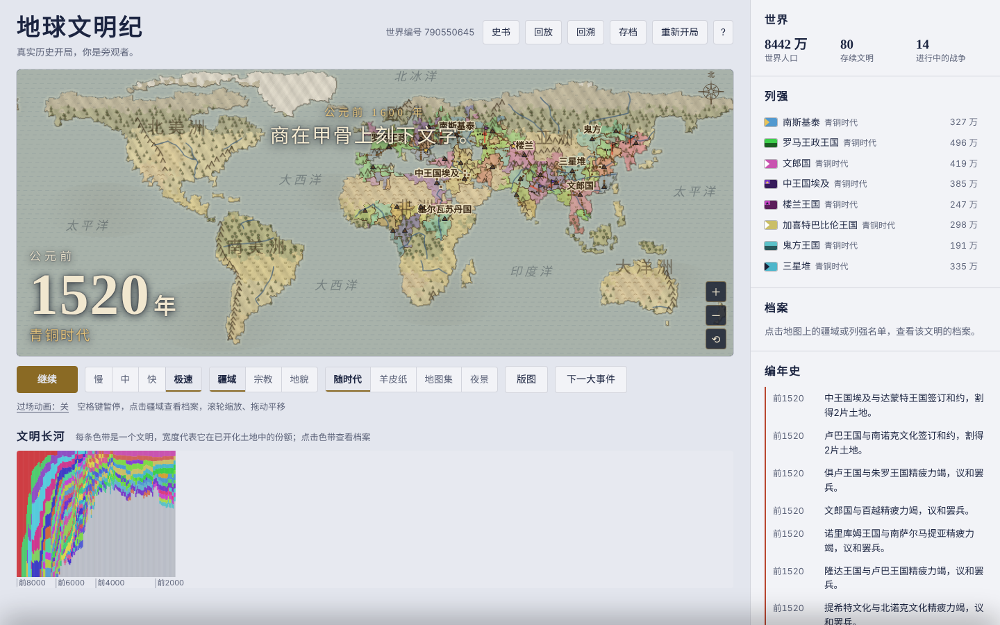

# 地球文明纪 · Earth Civilization Chronicle

**A solo-built browser strategy sim that replays 10,000 years of human history on a real world map — from the first farming villages in 8000 BC to the space age — and lets you watch, rule, or play god.**

▶ **[Play it in your browser](https://jasonmayg.github.io/earth-civilization/)** — no install, works on desktop and mobile. (Interface in Chinese.)

   
  1520 BC — dozens of civilizations across a real-geography map; the chronicle on the right records every war, treaty and invention

## What it is

A self-contained simulation (one HTML file, no server) where civilizations are born in river valleys, grow, split, convert, trade, fight and fall. Every run is a different alternate history, and every world is reproducible from its seed.

**Three ways to start a world**

| Origin | Description |
|---|---|
| Random evolution | Start in 8000 BC; names, cradles and outcomes are all procedural |
| Real history | 37 ancient civilizations appear at their real times and places, then history diverges |
| Modern start | ~110 present-day countries from 2025, starting from approximate real-world economy, tech, military, alliances and climate |

**Three ways to play**

| Role | Description |
|---|---|
| Observer | Hands off — let history write itself and read the chronicle |
| Ruler | Take over any civilization: treasury, policies, diplomacy, wonders |
| God | Spend divine power on revelations, plagues, great leaders and natural disasters |

Plus 8 scenario challenges (e.g. *Rome Eternal*, *King of the Steppe*, *A Century of Peace*), a versus mode, 14 world wonders from the Pyramids to a space elevator, 11 technological eras, emergent religions, 13 achievements, save/replay/rewind, and several map styles (parchment, atlas, night lights).

  
   
  Left: choose an origin and a role. Right: 490 BC — the "river of civilizations" chart below the map shows each civilization's share of the world over time.

## Design decisions

**Make history legible, not just simulated.** A simulation with hundreds of actors is noise unless the player can follow it. Three layers do that work: a running **chronicle** of discrete events ("Shang carves writing on oracle bones"), a **river-of-civilizations** chart that shows rise and fall at a glance, and **cinematic captions** for the biggest moments. "Next major event" lets players jump straight to what matters.

**Anchor the fiction in reality.** The world map, biomes and river valleys follow real geography, and the *Real History* mode seeds real civilizations at real dates, with real-world parallels surfaced as they happen ("in real history, Confucius was born in 551 BC…"). Familiar anchors make the divergence interesting.

**Same engine, three levels of agency.** Observer, Ruler and God are not separate games — they are different control surfaces on one simulation. This kept scope manageable while serving very different player motivations (watchers, strategists, sandbox tinkerers).

**Deterministic by seed.** A seeded RNG means any world can be shared and replayed exactly — useful for debugging balance, and for players comparing runs.

**AI-native, but never AI-dependent.** When hosted on Claude, an LLM reads the run's chronicle and writes a full *History Book* of that alternate world, and an online mode lets several people share one world. Everywhere else the game detects the missing capability and runs fully offline — the AI layer is an enhancement, not a requirement.

## Tech

- Single-file HTML/CSS/JavaScript, Canvas rendering, no build step, no dependencies
- 180×90 cell world grid with biomes, regions and river valleys; seeded PRNG (mulberry32)
- Saves in browser local storage
- Optional AI chronicle (`window.claude.use('sample')`) and multiplayer rooms (`window.claude.use('room')`), with graceful fallback

## Run locally

Download `index.html` and open it in any modern browser. That's it.

## Credits

Designed and built solo by **Jason Geng** — game design, simulation rules, historical data, UI and balancing.

---

© 2026 Jason Geng. All rights reserved. Shared for portfolio review.
